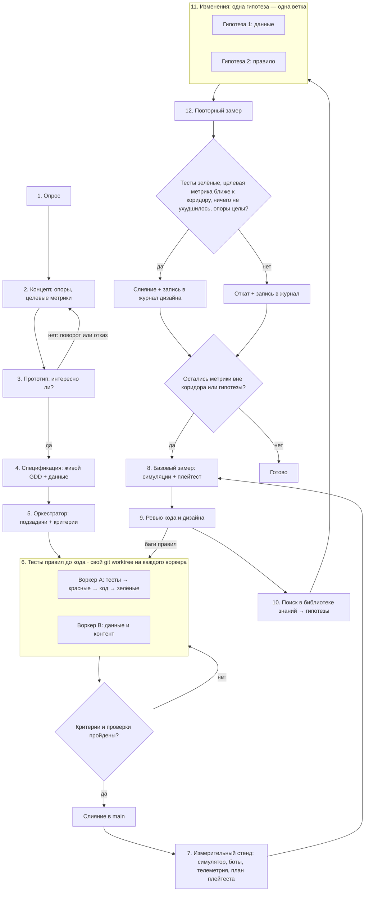

# Пайплайн геймдизайна: от идеи до баланса, подтверждённого замерами

Порядок работы над игрой или игровой системой: от постановки и прототипа до спецификации, кода с зелёными тестами правил, затем цикл улучшения дизайна. В цикле дизайн меняется только по замерам: симуляциям партий ботами, метрикам плейтестов и экономическим моделям. Каждая правка опирается на источник из библиотеки знаний скилла. Пайплайн подходит для любых жанров; примеры в тексте — в основном из карточных и пошаговых игр, где автоматический замер даёт больше всего.

- [Чем отличается от пайплайна для кода](#чем-отличается-от-пайплайна-для-кода)
- [Схема](#схема)
- [Роли и модели](#роли-и-модели)
- [Этапы](#этапы)
- [Этап 2. Опоры и целевые метрики](#этап-2-опоры-и-целевые-метрики)
- [Этап 3. Прототип](#этап-3-прототип)
- [Этап 4. Спецификация](#этап-4-спецификация)
- [Этап 6. Тесты правил](#этап-6-тесты-правил)
- [Этап 7. Измерительный стенд](#этап-7-измерительный-стенд)
- [Этап 8. Базовый замер](#этап-8-базовый-замер)
- [Этап 9. Ревью кода и дизайна](#этап-9-ревью-кода-и-дизайна)
- [Этап 10. Поиск в библиотеке знаний](#этап-10-поиск-в-библиотеке-знаний)
- [Этапы 11–12. Изменение и повторный замер](#этапы-1112-изменение-и-повторный-замер)
- [Короткий режим](#короткий-режим)
- [Почему так](#почему-так)

## Чем отличается от пайплайна для кода

Каркас взят из пайплайна для кода: тесты до кода, бенчмарки, базовый замер, ревью, гипотезы из библиотеки, повторный замер. Для геймдизайна в нём четыре изменения.

| В пайплайне для кода | В пайплайне геймдизайна | Почему |
| --- | --- | --- |
| Бенчмарк меряет скорость | Стенд меряет **метрики дизайна**: доли побед, длину партии, разброс колод, темп экономики, прохождение обучения. Скорость кода остаётся отдельной веткой | Цель геймдизайна — опыт игрока, а не миллисекунды |
| «Лучше» значит «быстрее» | «Лучше» значит **ближе к целевому коридору**, который задан на этапе 2. Доля побед 58% → 51% — улучшение, 50% → 44% — ухудшение | У большинства метрик дизайна нет направления «чем больше, тем лучше» |
| Сразу спецификация | Перед спецификацией идёт **прототип**, который проверяет, интересно ли играть | Дешевле выбросить бумажный прототип, чем готовую систему |
| Тесты заморожены целиком | Заморожены **тесты механик и стенд**. Тесты на конкретные числа (стоимость карты, урон) гипотеза может менять, если явно их перечислила | Балансная правка по определению меняет числа |

Симуляция меряет баланс и динамику, но не «интересно ли». Поэтому гипотезы про ощущения, понятность и удовольствие подтверждаются плейтестом с людьми, а не только ботами.

## Схема



## Роли и модели

Пайплайн рассчитан на агента с субагентами. Если субагентов нет, один агент проходит те же этапы последовательно, а вместо worktree использует отдельные ветки.

| Роль | Рекомендуемая модель | Этапы |
| --- | --- | --- |
| Оркестратор: опрос, концепт, спецификация, распределение работы, ревью, поиск решений, приёмка | Старшая модель, например Claude Opus 5.5 | 1–5, приёмка, 9, 10, решение на 12 |
| Воркер: код правил, тесты, симулятор и боты, правки гипотез | Средняя модель, например Claude Sonnet 5.5 | 6, 7, 11 |
| Рутина: данные и таблицы, прогоны симуляций, сбор цифр | Быстрая модель, например Claude Haiku 4.5 | 6 (данные), 8, 12 (замер) |
| **Человек**: дизайнер, плейтестеры | — | решение на 3, плейтесты на 8 и 12, финальное слово по опорам и «интересно ли» |

Агент не играет в игру глазами и руками. Всё, что можно посчитать (правила, баланс, экономика, длина партии), считается кодом. То, что требует человека (удовольствие, понятность, ощущение управления, эмоции от темы), оркестратор передаёт на плейтест со списком вопросов и наблюдений.

## Этапы

| Этап | Что делает | Команда агенту |
| --- | --- | --- |
| 1. Опрос | Уточняет: жанр и референсы, платформа, аудитория, желаемый опыт игрока (эстетики MDA), длина сессии и партии, число игроков, PvP или PvE, монетизация, команда и сроки, что уже есть | «Прежде чем начать, задай мне вопросы по игре» |
| 2. Концепт, опоры, целевые метрики | One-pager: фантазия игрока, 3–5 опор дизайна, основной цикл, и **целевые коридоры метрик** в `design/targets.json` | «Составь one-pager, опоры и целевые коридоры метрик» |
| 3. Прототип | Самый дешёвый прототип, отвечающий на один вопрос «интересно ли»: бумажный, таблица, серый бокс. Решение принимает человек: продолжить, повернуть, бросить | «Сделай прототип, который проверяет только вопрос N» |
| 4. Спецификация | Живой GDD: спецификации систем с правилами в форме примеров «дано / когда / тогда», таблицы данных (карты, юниты, награды) как источник правды | «Опиши систему N спецификацией с примерами правил и таблицей данных» |
| 5. Оркестратор | Делит на подзадачи с критериями приёмки. Отделяет правила от представления и данные от кода по [architecture-code.md](architecture-code.md) | «Разбей спецификацию на подзадачи с критериями готовности» |
| 6. Тесты правил до кода | Примеры из спецификации превращаются в тесты, затем код до зелёных. Отдельный worktree на воркера | «Сначала тесты по примерам из спеки, запусти — должны быть красными. Потом код до зелёных» |
| Приёмка | Сверяет с критериями, тестами и валидацией данных: слияние или возврат | «Проверь ветку по критериям, покажи вывод тестов и валидации данных» |
| 7. Измерительный стенд | Симулятор партий с ботами нескольких стилей, запись JSONL, телеметрия, план плейтеста, бенчмарки скорости горячих путей. После этапа стенд заморожен | «Сделай стенд: безголовый симулятор, боты, JSONL по схеме из pipeline.md» |
| 8. Базовый замер | Прогон симуляций с фиксированными seed → `metrics/before.json`; раунд плейтеста → отчёт | «Прогони N партий, сведи метрики design_metrics.py, покажи метрики вне коридора» |
| 9. Ревью кода и дизайна | Ревью кода правил и ревью дизайна по чеклистам. Находки делятся на баги правил и проблемы дизайна | «Сделай ревью кода и дизайна: баги отдельно, проблемы дизайна отдельно» |
| 10. Поиск в библиотеке знаний | От симптома (метрика вне коридора, замечание ревью, наблюдение плейтеста) к решению с источником → карточки гипотез | «По замеру и ревью найди решения в библиотеке знаний и оформи карточки гипотез» |
| 11. Изменения | Каждая гипотеза отдельно; стенд и тесты механик не меняются | «Реализуй гипотезу N в отдельной ветке, стенд и тесты механик не трогай» |
| 12. Повторный замер | Те же seed и боты; `metrics_compare.py` против базовой линии; плейтест, если гипотеза про ощущения. Оркестратор решает: слить или откатить | «Сравни с базовой линией metrics_compare.py и покажи вердикты по каждой метрике» |

## Этап 2. Опоры и целевые метрики

Целевые метрики — аналог бюджета производительности. Без них этапы 8–12 не могут сказать, стало лучше или хуже.

- **Опоры (pillars)** — 3–5 коротких утверждений о желаемом опыте, по которым принимаются решения: «каждый ход — трудный выбор», «камбэк возможен до последнего хода». Подробнее: [foundations.md](foundations.md), [documentation.md](documentation.md).
- **Каждая опора, которую можно измерить, получает метрику и коридор.** «Камбэк возможен» → доля партий, выигранных отстававшим по ресурсам на середине партии, не ниже X%. «Партия на 10 минут» → медиана числа ходов в коридоре.
- **Коридоры берутся из источников и референсов**, а не из головы: ориентиры собраны в [systems-balance.md](systems-balance.md) и [playtesting-metrics.md](playtesting-metrics.md). Если ориентира нет, коридор ставится по референсной игре и помечается как предположение.
- Коридоры записываются в `design/targets.json` в формате [metrics_compare.py](../scripts/metrics_compare.py):

```json
{
  "rate:win@went_first=true": {"min": 0.47, "max": 0.53},
  "rate:win@deck=*,*":        {"min": 0.35, "max": 0.65},
  "rate:win@deck=*":          {"min": 0.45, "max": 0.55},
  "spread:win@deck":          {"max": 0.10},
  "num:turns@went_first=true": {"min": 7, "max": 12, "stat": "median"},
  "rate:comeback":            {"min": 0.20},
  "rate:finished_tutorial":   {"better": "higher"}
}
```

Ключ — шаблон имени метрики, побеждает **первый** подходящий, поэтому частные шаблоны (`deck=*,*` для матчапов) стоят выше общих (`deck=*`).

## Этап 3. Прототип

- Прототип отвечает на **один вопрос**, записанный до начала: «интересен ли выбор между атакой и накоплением ресурса?». Всё, что не нужно для ответа, не делается.
- Порядок по цене: бумага и карточки → таблица или скрипт → серый бокс в движке. Для карточных игр бумажный прототип или Tabletop Simulator почти всегда быстрее кода.
- Итог — короткая запись: вопрос, что сделали, что увидели, решение. Решение «интересно или нет» принимает человек после игры, агент готовит прототип и вопросы для наблюдения.
- Источники и приёмы: [documentation.md](documentation.md) → «Прототипирование».

## Этап 4. Спецификация

- **Живой документ, а не том.** Одна страница на систему, ссылки между страницами, журнал решений. Структура и шаблоны: [documentation.md](documentation.md) и [assets/](../assets/).
- **Правила — примерами.** Каждое правило сопровождается примером «дано / когда / тогда» с конкретными картами или юнитами. Такие примеры однозначны для агента и превращаются в тесты на этапе 6.
- **Данные отдельно от правил.** Карты, юниты, награды и кривые лежат в таблицах или файлах данных, которые читает код. Балансная правка на этапе 11 тогда меняет данные, а не код.
- **Отдельно перечисляются горячие пути кода**: проверка законности хода, применение эффектов, перебор ходов ботом. Если боты медленные, симуляция на этапе 8 займёт часы.

## Этап 6. Тесты правил

- **Тесты механик**: каждое правило из спецификации, взаимодействия эффектов, порядок срабатывания, крайние случаи (пустая колода, ничья, одновременная смерть). Эти тесты заморожены на этапах 11–12.
- **Тесты данных**: схема и инварианты таблиц. Например, у каждой карты есть стоимость, ссылки на эффекты существуют, кривая наград монотонна. Конкретные числа баланса в тестах механик не фиксируются.
- **Детерминизм**: одна и та же партия с тем же seed и теми же решениями даёт тот же результат. Без этого замеры не сравнить, а баги не воспроизвести. Реплей партии — лучший регрессионный тест ([architecture-code.md](architecture-code.md)).
- **Законность ходов ботов**: случайный бот играет тысячи партий без исключений и зависаний. Это дешёвый фаззинг правил.
- Чеклисты по языку и движку — в скиллах rust-knowledge и gdscript-knowledge, если они установлены.

## Этап 7. Измерительный стенд

Стенд — контракт, как бенчмарки в пайплайне для кода. После этапа 7 не меняются боты, seed, схема записи и определения метрик. Иначе сравнение с базовой линией теряет смысл.

**Симулятор партий** — безголовый (без графики) запуск правил, который играет партию ботами и пишет **одну строку JSONL на игрока в партии**:

```json
{"match": 1812, "seed": 1812, "deck": "Aggro", "opp_deck": "Control", "bot": "greedy", "went_first": true, "win": true, "turns": 9, "comeback": false, "mana_screw": false}
```

Одна строка на игрока, а не на партию, даёт все разрезы одной командой. `rate:win@went_first=true` — преимущество первого хода, `rate:win@deck=X` — сила колоды, разрез `deck,opp_deck` — матрица матчапов. Зеркальные матчи дают ровно 50% по построению, поэтому колоды сравнивайте по матрице или исключайте зеркала из выборки.

Поля уровня партии (`turns`, `lead_changes`, `drama`) повторяются в обеих строках партии. Читайте их через разрез `@went_first=true`, где на партию ровно одна строка: `num:turns@went_first=true`. Метрика `num:turns` по всем строкам удваивает n, и её интервалы и тесты получаются слишком оптимистичными. Поля уровня игрока (`win`, `comeback` — «победил, отставая на середине партии», `mana_screw`) читаются по всем строкам. Полная схема полей и соответствие метрикам — в [playtesting-metrics.md](playtesting-metrics.md).

**Боты нескольких стилей**. Один бот меряет не игру, а свою стратегию.

| Бот | Что меряет |
| --- | --- |
| Случайный (из законных ходов) | Законность правил, нижняя граница, доля удачи: если случайный бот часто побеждает умного, решения мало значат |
| Жадный (лучший ход на один шаг вперёд) | Базовый баланс, очевидные сильные карты |
| Поиск (MCTS / ISMCTS для скрытой информации) или эвристический по стилю (агро, контроль) | Баланс при сильной игре, доминирующие стратегии |
| Ограниченный (запрет на механику X) | Важность механики: насколько падает доля побед, если её не использовать |

Источники по ботам и автоматическому плейтесту: [playtesting-metrics.md](playtesting-metrics.md), [architecture-code.md](architecture-code.md) → игровой ИИ.

**Сколько партий.** Число партий выбирается под точность, а не «на глаз»:

```bash
python3 scripts/sample_size.py margin 0.02     # ±2 п.п. для одной доли → 2401 партия
python3 scripts/sample_size.py diff 0.50 0.53  # заметить сдвиг 50% → 53% между версиями → 4356 на версию
```

Для разрезов считайте партии **на группу**: десять колод по 2401 партии на колоду — это 24 тысячи партий.

**Экономика и прогрессия** меряются так же: симуляция игрока-бота на N дней или забегов пишет строку JSONL на сессию с полями вроде `gold`, `level`, `unlocked`. Модели источников и стоков — в [systems-balance.md](systems-balance.md).

**Плейтест с людьми** — план с вопросом, задачами, наблюдаемыми событиями и опросником. Его результаты тоже можно записать в JSONL, например `finished_tutorial` или `time_to_first_win`, но при 5–10 людях цифры служат ориентиром, а не доказательством. Шаблон: [assets/playtest-plan.md](../assets/playtest-plan.md); методы: [playtesting-metrics.md](playtesting-metrics.md).

**Скорость кода**: бенчмарки горячих путей (проверка хода, ход бота, загрузка) пишутся по пайплайну скилла для языка проекта. Медленный симулятор — тоже проблема дизайна: он ограничивает число партий в замере.

## Этап 8. Базовый замер

```bash
<симулятор> --games 5000 --seed-from 1 --bots greedy,mcts > runs/before.jsonl
python3 scripts/design_metrics.py runs/before.jsonl \
  --rate win --rate comeback --num turns \
  --by went_first --by deck --by deck,opp_deck \
  --meta sim=v1 --meta bots=greedy,mcts --meta seeds=1-5000 \
  --out metrics/before.json
```

- `--meta` записывает условия прогона. `metrics_compare.py` предупредит, если на повторном замере они другие.
- Итог этапа — таблица: метрики вне коридора, их значения с доверительными интервалами, группы с пометкой `low_n` (мало данных), и наблюдения плейтеста.
- Если ревью на этапе 9 нашло баги правил и код поменялся, базовую линию нужно снять заново.

## Этап 9. Ревью кода и дизайна

Ревью идёт до правок баланса: настраивать числа имеет смысл, когда правила работают как задумано.

- **Ревью кода**: стандартное ревью языка проекта плюс игровые пункты из [architecture-code.md](architecture-code.md): детерминизм, правила отделены от представления, данные валидируются, нет скрытого глобального состояния, эффекты взаимодействуют по спецификации.
- **Ревью дизайна** по [design-review.md](design-review.md):
  - соответствие опорам;
  - эвристики играбельности;
  - понятность и обучение;
  - доступность;
  - ловушки для новичков;
  - лишняя сложность.
- Находки делятся на две группы:
  - **баги** — правила работают не так, как в спецификации, падения, недетерминизм, незаконные ходы. Возвращаются на этап 6 с тестом, который воспроизводит баг;
  - **проблемы дизайна** — метрики вне коридора, замечания ревью, наблюдения плейтеста. Идут на вход этапа 10.

## Этап 10. Поиск в библиотеке знаний

Оркестратор идёт от симптома к решению. Главная точка входа — таблица «Симптом → решение → источник» в [mechanics-patterns.md](mechanics-patterns.md).

| Что видно в замере, ревью или плейтесте | Куда смотреть |
| --- | --- |
| Доля побед первого хода вне коридора, сильная колода или фракция, кривые матчапы, доминирующая стратегия | [mechanics-patterns.md](mechanics-patterns.md) → «Баланс и честность», [systems-balance.md](systems-balance.md) → баланс |
| Снежный ком, нет камбэков, партия решается рано, или наоборот, затянутый финал | [mechanics-patterns.md](mechanics-patterns.md) → «Темп и длительность», [systems-balance.md](systems-balance.md) → петли обратной связи |
| Случайный бот побеждает слишком часто, жалобы на удачу, мана-скрю | [mechanics-patterns.md](mechanics-patterns.md) → «Случайность», [systems-balance.md](systems-balance.md) → вероятности |
| Ходы без решений, очевидный лучший ход, analysis paralysis | [mechanics-patterns.md](mechanics-patterns.md) → «Решения и глубина», [foundations.md](foundations.md) |
| Инфляция, слишком быстрый или медленный прогресс, гринд | [systems-balance.md](systems-balance.md) → экономика и прогрессия |
| Игроки не понимают правила или цель, бросают обучение | [design-review.md](design-review.md) → обучение, [playtesting-metrics.md](playtesting-metrics.md) |
| Плохое ощущение управления, нет «сока» | [foundations.md](foundations.md) → game feel, [mechanics-patterns.md](mechanics-patterns.md) → «Управление и ощущение» |
| Проблема типична для жанра | [genres.md](genres.md) → раздел жанра |
| Медленный симулятор, недетерминизм, эффекты ломают друг друга | [architecture-code.md](architecture-code.md) |
| Нужно глубже разобраться в теме | [books.md](books.md) |

Результат этапа — список карточек гипотез, отсортированный по ожидаемому эффекту:

```text
Гипотеза N: <что меняем>
Тип: данные | правило | интерфейс | обучение
Где: <файл данных, система, экран>
Почему: <метрика вне коридора, замечание ревью или наблюдение плейтеста>
Источник: <ссылка из библиотеки знаний>
Ожидаемый эффект: <какая метрика, куда и насколько сдвинется>
Что может ухудшиться: <какие метрики проверить на регрессию>
Опоры: <не нарушает ли опоры дизайна>
Проверка: симуляция | плейтест | оба
Меняемые тесты: <тесты на числа, которые гипотеза обновляет; тесты механик не трогаются>
```

Если в библиотеке нет решения под найденную проблему, это пишется в карточке прямо, без выдуманного решения. Такой пробел — повод дополнить библиотеку.

Начинайте с самой маленькой правки. Сначала числа в данных, потом правило, и только потом новая механика: новая механика добавляет сложность и сама требует баланса.

## Этапы 11–12. Изменение и повторный замер

Каждая гипотеза реализуется в своей ветке или worktree, чтобы эффект был виден отдельно. Затем тот же стенд с теми же seed и ботами:

```bash
<симулятор> --games 5000 --seed-from 1 --bots greedy,mcts > runs/after.jsonl
python3 scripts/design_metrics.py runs/after.jsonl <те же флаги> --out metrics/after.json
python3 scripts/metrics_compare.py metrics/before.json metrics/after.json --targets design/targets.json
```

`metrics_compare.py` даёт по каждой метрике вердикт:

- `better` / `worse` — значимое изменение к коридору или от него;
- `shifted` — значимое изменение внутри коридора;
- `same` — изменение в пределах шума.

Код выхода 1 означает, что есть `worse`. Флаг `--holm` добавляет поправку на множественные сравнения для вердиктов `better`. Включайте его, если смотрите десятки разрезов сразу: иначе часть «улучшений» окажется случайной.

Гипотеза сливается в `main`, только если выполнены все условия:

1. Тесты механик и валидация данных зелёные.
2. У целевой метрики вердикт `better`: она вошла в коридор или значимо к нему приблизилась.
3. Ни у одной метрики нет `worse`.
4. Гипотеза про ощущения, понятность или удовольствие подтверждена плейтестом: симуляция такое не меряет.
5. Опоры дизайна не нарушены, сложность не выросла без нужды. Это проверяет оркестратор, а спорные случаи решает человек.

Иначе ветка удаляется. В обоих случаях результат записывается в журнал дизайна, например `docs/design-log.md`. Шаблон: [assets/design-log.md](../assets/design-log.md).

| Гипотеза | Источник | Метрика | До | После | Решение |
| --- | --- | --- | --- | --- | --- |
| Монета второму игроку (+1 ресурс один раз) | ссылка из библиотеки | `rate:win@went_first=true` | 56,8% | 51,8% | слита |

Журнал не даёт повторно проверять отклонённые идеи и служит историей баланса для патч-нотов. Если гипотезы сливались, перед следующим кругом снимается новая базовая линия. Цикл 8–12 повторяется, пока остаются метрики вне коридора или гипотезы с заметным ожидаемым эффектом.

## Короткий режим

Для одной балансной правки или одного правила весь пайплайн избыточен. Достаточно:

1. Карточка гипотезы с источником.
2. Правка данных или правила; тесты механик зелёные.
3. Замер до и после на одном стенде, `metrics_compare.py`.
4. Запись в журнал дизайна.

Если стенда ещё нет, короткий режим начинается с минимального стенда: случайный и жадный боты, JSONL, `design_metrics.py`.

## Почему так

- **Сначала интересно, потом правильно, потом сбалансировано.** Прототип отсекает скучную идею до спецификации, тесты правил отсекают баги до баланса, а баланс настраивается на работающих правилах.
- **Целевые коридоры — это контракт дизайна.** Их задают до замеров, из опор и референсов, поэтому «стало лучше» означает «ближе к задуманному», а не «цифра изменилась».
- **Стенд — тоже контракт.** Боты, seed и определения метрик заморожены, поэтому разница между замерами вызвана правкой, а не сменой линейки.
- **Решения берутся из источников.** Каждая гипотеза ссылается на материал библиотеки: проверенный приём или разбор у другой игры. Это отсекает выдуманные решения и сразу показывает побочные эффекты, о которых писали авторы.
- **Боты меряют баланс, люди меряют опыт.** Симуляция дешева и даёт тысячи партий, но не чувствует скуку и фрустрацию. Плейтест дорог, но только он отвечает, интересно ли.
- **Одна гипотеза — одна ветка.** Эффект каждой правки виден отдельно, и неудачную легко откатить, не задев удачные.
