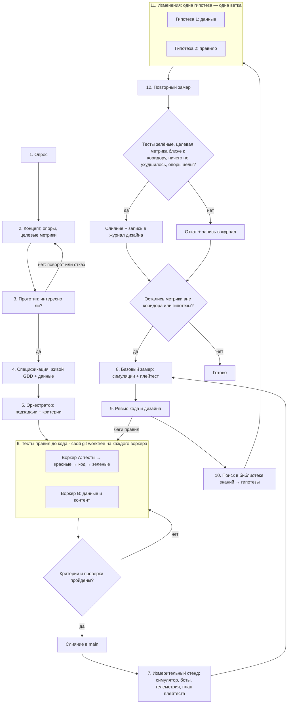

# Пайплайн геймдизайна: от идеи до баланса, подтверждённого замерами

Порядок работы над игрой или игровой системой: от постановки и прототипа до спецификации, кода с зелёными тестами правил, затем цикл улучшения дизайна. В цикле дизайн меняется только по замерам: симуляциям партий ботами, метрикам плейтестов и экономическим моделям. Каждая правка опирается на источник из библиотеки знаний скилла. Пайплайн подходит для любых жанров и масштабов: от головоломки и платформера до шутера, MOBA, RPG, стратегии, рогалика, карточной или F2P-игры. Меняется только стенд: что симулирует бот и что пишется в лог. Для игр, где честный бот дорог (экшен, гонки, открытые миры), основным источником замеров становятся телеметрия и плейтесты, а симуляция покрывает отдельные системы: экономику, прогрессию, бой, генерацию.

- [Чем отличается от пайплайна для кода](#чем-отличается-от-пайплайна-для-кода)
- [Схема](#схема)
- [Роли и модели](#роли-и-модели)
- [Этапы](#этапы)
- [Этап 2. Опоры и целевые метрики](#этап-2-опоры-и-целевые-метрики)
- [Этап 3. Прототип](#этап-3-прототип)
- [Этап 4. Спецификация](#этап-4-спецификация)
- [Этап 6. Тесты правил](#этап-6-тесты-правил)
- [Этап 7. Измерительный стенд](#этап-7-измерительный-стенд)
- [Этап 8. Базовый замер](#этап-8-базовый-замер)
- [Этап 9. Ревью кода и дизайна](#этап-9-ревью-кода-и-дизайна)
- [Этап 10. Поиск в библиотеке знаний](#этап-10-поиск-в-библиотеке-знаний)
- [Этапы 11–12. Изменение и повторный замер](#этапы-1112-изменение-и-повторный-замер)
- [Учебный прогон](#учебный-прогон)
- [Короткий режим](#короткий-режим)
- [Почему так](#почему-так)

## Чем отличается от пайплайна для кода

Каркас взят из пайплайна для кода: тесты до кода, бенчмарки, базовый замер, ревью, гипотезы из библиотеки, повторный замер. Для геймдизайна в нём четыре изменения.

| В пайплайне для кода | В пайплайне геймдизайна | Почему |
| --- | --- | --- |
| Бенчмарк меряет скорость | Стенд меряет **метрики дизайна**: доли побед, длину партии, разброс колод, темп экономики, прохождение обучения. Скорость кода остаётся отдельной веткой | Цель геймдизайна — опыт игрока, а не миллисекунды |
| «Лучше» значит «быстрее» | «Лучше» значит **ближе к целевому коридору**, который задан на этапе 2. Доля побед 58% → 51% — улучшение, 50% → 44% — ухудшение | У большинства метрик дизайна нет направления «чем больше, тем лучше» |
| Сразу спецификация | Перед спецификацией идёт **прототип**, который проверяет, интересно ли играть | Дешевле выбросить бумажный прототип, чем готовую систему |
| Тесты заморожены целиком | Заморожены **тесты механик и стенд**. Тесты на конкретные числа (стоимость карты, урон) гипотеза может менять, если явно их перечислила | Балансная правка по определению меняет числа |

Симуляция меряет баланс и динамику, но не «интересно ли». Поэтому гипотезы про ощущения, понятность и удовольствие подтверждаются плейтестом с людьми, а не только ботами.

## Схема



## Роли и модели

Пайплайн рассчитан на агента с субагентами. Если субагентов нет, один агент проходит те же этапы последовательно, а вместо worktree использует отдельные ветки.

| Роль | Рекомендуемая модель | Этапы |
| --- | --- | --- |
| Оркестратор: опрос, концепт, спецификация, распределение работы, ревью, поиск решений, приёмка | Старшая модель, например Claude Opus 5.5 | 1–5, приёмка, 9, 10, решение на 12 |
| Воркер: код правил, тесты, симулятор и боты, правки гипотез | Средняя модель, например Claude Sonnet 5.5 | 6, 7, 11 |
| Рутина: данные и таблицы, прогоны симуляций, сбор цифр | Быстрая модель, например Claude Haiku 4.5 | 6 (данные), 8, 12 (замер) |
| **Человек**: дизайнер, плейтестеры | — | решение на 3, плейтесты на 8 и 12, финальное слово по опорам и «интересно ли» |

Агент не играет в игру глазами и руками. Всё, что можно посчитать (правила, баланс, экономика, длина партии), считается кодом. То, что требует человека (удовольствие, понятность, ощущение управления, эмоции от темы), оркестратор передаёт на плейтест со списком вопросов и наблюдений.

## Этапы

| Этап | Что делает | Команда агенту |
| --- | --- | --- |
| 1. Опрос | Уточняет: жанр и референсы, платформа, аудитория, желаемый опыт игрока (эстетики MDA), длина сессии и партии, число игроков, PvP или PvE, монетизация, команда и сроки, что уже есть | «Прежде чем начать, задай мне вопросы по игре» |
| 2. Концепт, опоры, целевые метрики | One-pager: фантазия игрока, 3–5 опор дизайна, основной цикл, и **целевые коридоры метрик** в `design/targets.json` | «Составь one-pager, опоры и целевые коридоры метрик» |
| 3. Прототип | Самый дешёвый прототип, отвечающий на один вопрос «интересно ли»: бумажный, таблица, серый бокс. Решение принимает человек: продолжить, повернуть, бросить | «Сделай прототип, который проверяет только вопрос N» |
| 4. Спецификация | Живой GDD: спецификации систем с правилами в форме примеров «дано / когда / тогда», таблицы данных (карты, юниты, награды) как источник правды | «Опиши систему N спецификацией с примерами правил и таблицей данных» |
| 5. Оркестратор | Делит на подзадачи с критериями приёмки. Отделяет правила от представления и данные от кода по [architecture-code.md](architecture-code.md) | «Разбей спецификацию на подзадачи с критериями готовности» |
| 6. Тесты правил до кода | Примеры из спецификации превращаются в тесты, затем код до зелёных. Отдельный worktree на воркера | «Сначала тесты по примерам из спеки, запусти — должны быть красными. Потом код до зелёных» |
| Приёмка | Сверяет с критериями, тестами и валидацией данных: слияние или возврат | «Проверь ветку по критериям, покажи вывод тестов и валидации данных» |
| 7. Измерительный стенд | Симулятор партий с ботами нескольких стилей, запись JSONL, телеметрия, план плейтеста, бенчмарки скорости горячих путей. После этапа стенд заморожен | «Сделай стенд: безголовый симулятор, боты, JSONL по схеме из pipeline.md» |
| 8. Базовый замер | Прогон симуляций с фиксированными seed → `metrics/before.json`; раунд плейтеста → отчёт | «Прогони N партий, сведи метрики design_metrics.py, покажи метрики вне коридора» |
| 9. Ревью кода и дизайна | Ревью кода правил и ревью дизайна по чеклистам. Находки делятся на баги правил и проблемы дизайна | «Сделай ревью кода и дизайна: баги отдельно, проблемы дизайна отдельно» |
| 10. Поиск в библиотеке знаний | От симптома (метрика вне коридора, замечание ревью, наблюдение плейтеста) к решению с источником → карточки гипотез | «По замеру и ревью найди решения в библиотеке знаний и оформи карточки гипотез» |
| 11. Изменения | Каждая гипотеза отдельно; стенд и тесты механик не меняются | «Реализуй гипотезу N в отдельной ветке, стенд и тесты механик не трогай» |
| 12. Повторный замер | Те же seed и боты; `metrics_compare.py` против базовой линии; плейтест, если гипотеза про ощущения. Оркестратор решает: слить или откатить | «Сравни с базовой линией metrics_compare.py и покажи вердикты по каждой метрике» |

## Этап 2. Опоры и целевые метрики

Целевые метрики — аналог бюджета производительности. Без них этапы 8–12 не могут сказать, стало лучше или хуже.

- **Опоры (pillars)** — 3–5 коротких утверждений о желаемом опыте, по которым принимаются решения: «каждое решение — трудный выбор», «камбэк возможен до конца», «смерть всегда понятна», «уровень проходится без подсказок». Подробнее: [foundations.md](foundations.md), [documentation.md](documentation.md).
- **Каждая опора, которую можно измерить, получает метрику и коридор.** «Камбэк возможен» → доля матчей, выигранных отстававшим на середине, не ниже X%. «Сессия на 10 минут» → медиана длительности в коридоре. «Обучение без стены» → доля прошедших первый уровень не ниже X%. «Все персонажи жизнеспособны» → разброс долей побед не больше X п.п.
- **Коридоры берутся из источников и референсов**, а не из головы: ориентиры собраны в [systems-balance.md](systems-balance.md), [playtesting-metrics.md](playtesting-metrics.md) и [genres.md](genres.md). Если ориентира нет, коридор ставится по референсной игре и помечается как предположение.
- Коридоры записываются в `design/targets.json` в формате [metrics_compare.py](../scripts/metrics_compare.py). Стартовые файлы для разных типов игр — в [assets/targets/](../assets/targets/README.md): дуэль 1×1, командный PvP, забеги рогалика, уровни, экономика и прогрессия. Пример для игры с уровнями:

```json
{
  "rate:completed@level=1-*":   {"min": 0.90},
  "rate:completed@level=*":     {"min": 0.60},
  "num:attempts@level=*":       {"max": 8, "stat": "median"},
  "rate:quit_on_level@level=*": {"max": 0.10},
  "rate:win@pick=*":            {"min": 0.45, "max": 0.55},
  "rate:finished_tutorial":     {"better": "higher"}
}
```

Ключ — шаблон имени метрики, побеждает **первый** подходящий, поэтому частные шаблоны (`level=1-*` для первого мира) стоят выше общих (`level=*`).

## Этап 3. Прототип

- Прототип отвечает на **один вопрос**, записанный до начала: «приятно ли управлять прыжком?», «интересен ли выбор между атакой и накоплением ресурса?», «понятна ли головоломка без текста?». Всё, что не нужно для ответа, не делается.
- Порядок по цене: бумага и карточки → таблица или скрипт → серый бокс в движке. Для систем, экономики, пошаговых и настольных механик бумага или таблица почти всегда быстрее кода. Для управления, камеры и ощущения от действия нужен серый бокс: на бумаге их не проверить.
- Итог — короткая запись: вопрос, что сделали, что увидели, решение. Решение «интересно или нет» принимает человек после игры, агент готовит прототип и вопросы для наблюдения.
- Источники и приёмы: [documentation.md](documentation.md) → «Прототипирование».

## Этап 4. Спецификация

- **Живой документ, а не том.** Одна страница на систему, ссылки между страницами, журнал решений. Структура и шаблоны: [documentation.md](documentation.md) и [assets/](../assets/).
- **Правила — примерами.** Каждое правило сопровождается примером «дано / когда / тогда» с конкретными объектами: персонаж с 30 здоровья получает удар 12 при броне 5, игрок нажимает прыжок через 3 кадра после схода с края. Такие примеры однозначны для агента и превращаются в тесты на этапе 6.
- **Данные отдельно от правил.** Персонажи, оружие, враги, карты, уровни, награды и кривые лежат в таблицах или файлах данных, которые читает код. Балансная правка на этапе 11 тогда меняет данные, а не код.
- **Отдельно перечисляются горячие пути кода**: шаг симуляции, применение эффектов, решение бота, генерация уровня. Если стенд медленный, замер на этапе 8 займёт часы.

## Этап 6. Тесты правил

- **Тесты механик**: каждое правило из спецификации, взаимодействия эффектов, порядок срабатывания, крайние случаи (нулевое здоровье, одновременная смерть, пустой инвентарь, выход за границу уровня, ничья). Эти тесты заморожены на этапах 11–12.
- **Тесты данных**: схема и инварианты таблиц. Например, у каждого предмета есть цена, ссылки на эффекты существуют, кривая опыта монотонна, у каждого уровня есть выход. Конкретные числа баланса в тестах механик не фиксируются.
- **Детерминизм** там, где он нужен для замеров: одна и та же партия или забег с тем же seed и тем же вводом даёт тот же результат. Без этого замеры не сравнить, а баги не воспроизвести. Реплей — лучший регрессионный тест ([architecture-code.md](architecture-code.md)). В играх на физике движка полный детерминизм дорог; тогда записывают ввод и снапшоты, а стенд меряет системы, которые можно сделать детерминированными.
- **Устойчивость к случайному вводу**: случайный бот или фаззер ввода играет тысячи партий, забегов или попыток без исключений, зависаний и выхода за границы мира. Это дешёвый фаззинг правил.
- Чеклисты по языку и движку — в профильных скиллах (rust-knowledge, gdscript-knowledge, python-knowledge), если они установлены.

## Этап 7. Измерительный стенд

Стенд — контракт, как бенчмарки в пайплайне для кода. После этапа 7 не меняются боты, seed, схема записи и определения метрик. Иначе сравнение с базовой линией теряет смысл.

**Стенд** — безголовый (без графики) запуск правил или системы, который играет ботами и пишет **одну строку JSONL на единицу наблюдения**. Единица зависит от игры:

| Тип игры | Одна строка | Пример строки |
| --- | --- | --- |
| Матч: дуэль, командный PvP, спорт | игрок в матче | `{"match": 1812, "seed": 1812, "pick": "Ranger", "opp_pick": "Tank", "side": "blue", "bot": "greedy", "went_first": true, "win": true, "duration_s": 540, "comeback": false}` |
| Забег: рогалик, roguelite, экстракшн | забег | `{"run": 77, "seed": 77, "character": "mage", "bot": "greedy", "win": false, "floor_reached": 5, "run_minutes": 31}` |
| Уровни: платформер, головоломка, кампания | игрок на уровне | `{"player": "p12", "level": "2-3", "completed": true, "attempts": 6, "time_s": 214, "deaths_at": [3, 3, 7]}` |
| Экономика, прогрессия, idle, F2P | симулированный игрок на день | `{"player": 5, "day": 7, "gold": 5200, "level": 15, "sink_ratio": 0.9, "stuck": false}` |
| Генератор уровней или контента | сгенерированный объект | `{"seed": 9, "solvable": true, "path_len": 48, "rooms": 11, "difficulty": 0.62}` — см. [procedural-generation.md](procedural-generation.md) |

`pick` — то, что выбирает игрок: персонаж, герой, колода, фракция, оружие, сборка, машина. Одна строка на игрока, а не на матч, даёт все разрезы одной командой. `rate:win@pick=X` — сила варианта, разрез `pick,opp_pick` — матрица матчапов, `rate:win@side=*` — перекос сторон карты, `rate:win@went_first=true` — преимущество первого хода в пошаговой игре. Зеркальные матчи дают ровно 50% по построению, поэтому варианты сравнивайте по матрице или исключайте зеркала.

Поля уровня матча (`duration_s`, `turns`, `lead_changes`, `drama`) повторяются в строке каждого игрока. Читайте их через разрез, где на матч ровно одна строка: `num:duration_s@side=blue` или `num:turns@went_first=true`. Метрика по всем строкам умножает n, и её интервалы и тесты получаются слишком оптимистичными. Поля уровня игрока (`win`, `comeback` — «победил, отставая на середине») читаются по всем строкам. Полная схема полей и соответствие метрикам — в [playtesting-metrics.md](playtesting-metrics.md).

**Боты нескольких стилей**. Один бот меряет не игру, а свою стратегию.

| Бот | Что меряет |
| --- | --- |
| Случайный (случайные законные действия или случайный ввод) | Устойчивость правил, нижняя граница, доля удачи: если случайный бот часто побеждает умного, решения мало значат |
| Жадный (лучшее действие на один шаг вперёд) | Базовый баланс, очевидно сильные варианты |
| Поиск (MCTS, ISMCTS для скрытой информации) или эвристический по стилю (агрессивный, осторожный, «спидраннер») | Баланс при сильной игре, доминирующие стратегии |
| Ограниченный (запрет на механику X, сниженная точность или реакция) | Важность механики; сложность для игроков разного мастерства — в экшене бот с ограниченной точностью прицела и временем реакции моделирует новичка |

Для экшена, шутеров и гонок честный бот сложнее: он должен видеть мир через те же ограничения, что и игрок. Там стенд часто ограничен системами (бой «в вакууме», экономика, прогрессия), а сложность уровней мерится телеметрией плейтестов. Подходы и источники — [playtesting-metrics.md](playtesting-metrics.md) и [architecture-code.md](architecture-code.md) → игровой ИИ.

Источники по ботам и автоматическому плейтесту: [playtesting-metrics.md](playtesting-metrics.md), [architecture-code.md](architecture-code.md) → игровой ИИ.

**Сколько партий.** Число партий выбирается под точность, а не «на глаз»:

```bash
python3 scripts/sample_size.py margin 0.02     # ±2 п.п. для одной доли → 2401 партия
python3 scripts/sample_size.py diff 0.50 0.53  # заметить сдвиг 50% → 53% между версиями → 4356 на версию
```

Для разрезов считайте партии **на группу**: десять персонажей по 2401 матчу на каждого — это 24 тысячи матчей.

**Экономика и прогрессия** меряются так же: симуляция игрока-бота на N дней или забегов пишет строку JSONL на день или сессию с полями вроде `gold`, `level`, `unlocked`. Модели источников и стоков — в [systems-balance.md](systems-balance.md).

**Учебные стенды скилла** — два игрушечных симулятора, на которых цикл 8–12 проходится за минуту и которые можно взять шаблоном: [example_sim.py](../scripts/example_sim.py) (дуэль 1×1, строка на игрока в матче) и [example_runs_sim.py](../scripts/example_runs_sim.py) (рогалик, строка на забег). Разбор — в разделе [«Учебный прогон»](#учебный-прогон).

**Плейтест с людьми** — план с вопросом, задачами, наблюдаемыми событиями и опросником. Его результаты тоже можно записать в JSONL, например `finished_tutorial` или `time_to_first_win`, но при 5–10 людях цифры служат ориентиром, а не доказательством. Шаблон: [assets/playtest-plan.md](../assets/playtest-plan.md); методы: [playtesting-metrics.md](playtesting-metrics.md).

**Скорость кода**: бенчмарки горячих путей (шаг симуляции, решение бота, загрузка, генерация) пишутся по пайплайну скилла для языка проекта. Медленный симулятор — тоже проблема дизайна: он ограничивает число партий в замере.

## Этап 8. Базовый замер

```bash
<стенд> --games 5000 --seed-from 1 --bots greedy,mcts > runs/before.jsonl
python3 scripts/design_metrics.py runs/before.jsonl \
  --rate win --rate comeback --num duration_s \
  --by side --by pick --by pick,opp_pick \
  --meta sim=v1 --meta bots=greedy,mcts --meta seeds=1-5000 \
  --out metrics/before.json
python3 scripts/meta_equilibrium.py metrics/before.json     # если есть матчапы: кто доминирует в мете
```

- `--meta` записывает условия прогона. `metrics_compare.py` предупредит, если на повторном замере они другие.
- Итог этапа — таблица: метрики вне коридора, их значения с доверительными интервалами, группы с пометкой `low_n` (мало данных), и наблюдения плейтеста.
- Если ревью на этапе 9 нашло баги правил и код поменялся, базовую линию нужно снять заново.

## Этап 9. Ревью кода и дизайна

Ревью идёт до правок баланса: настраивать числа имеет смысл, когда правила работают как задумано.

- **Ревью кода**: стандартное ревью языка проекта плюс игровые пункты из [architecture-code.md](architecture-code.md): детерминизм, правила отделены от представления, данные валидируются, нет скрытого глобального состояния, эффекты взаимодействуют по спецификации.
- **Ревью дизайна** по [design-review.md](design-review.md):
  - соответствие опорам;
  - эвристики играбельности;
  - понятность и обучение;
  - доступность;
  - ловушки для новичков;
  - лишняя сложность.
- Находки делятся на две группы:
  - **баги** — правила работают не так, как в спецификации, падения, недетерминизм, незаконные ходы. Возвращаются на этап 6 с тестом, который воспроизводит баг;
  - **проблемы дизайна** — метрики вне коридора, замечания ревью, наблюдения плейтеста. Идут на вход этапа 10.

## Этап 10. Поиск в библиотеке знаний

Оркестратор идёт от симптома к решению. Главная точка входа — таблица «Симптом → решение → источник» в [mechanics-patterns.md](mechanics-patterns.md).

| Что видно в замере, ревью или плейтесте | Куда смотреть |
| --- | --- |
| Сильный или слабый персонаж, герой, оружие, колода, фракция; перекос сторон карты или первого хода; кривые матчапы; доминирующая стратегия | [mechanics-patterns.md](mechanics-patterns.md) → «Баланс и честность», [systems-balance.md](systems-balance.md) → баланс и боевая математика; `meta_equilibrium.py` для матчапов, `cost_curve.py` для цен |
| Снежный ком, нет камбэков, матч решается рано, или наоборот, затянутый финал | [mechanics-patterns.md](mechanics-patterns.md) → «Темп и длительность», [systems-balance.md](systems-balance.md) → петли обратной связи |
| Случайный бот побеждает слишком часто, жалобы на удачу, «не повезло с раздачей или выпадением» | [mechanics-patterns.md](mechanics-patterns.md) → «Случайность», [systems-balance.md](systems-balance.md) → вероятности; `deck_odds.py` для колод, мешков и лут-пулов |
| Действия без решений, очевидный лучший ход, analysis paralysis | [mechanics-patterns.md](mechanics-patterns.md) → «Решения и глубина», [foundations.md](foundations.md) |
| Стена сложности, слишком лёгкий или резкий рост, игроки бросают на одном уровне или этаже | [systems-balance.md](systems-balance.md) → сложность, [genres.md](genres.md) → раздел жанра, [playtesting-metrics.md](playtesting-metrics.md) → метрики уровней |
| Инфляция, слишком быстрый или медленный прогресс, гринд | [systems-balance.md](systems-balance.md) → экономика и прогрессия |
| Игроки не понимают правила или цель, бросают обучение | [design-review.md](design-review.md) → обучение, [playtesting-metrics.md](playtesting-metrics.md), [ux-ui.md](ux-ui.md) → HUD и читаемость |
| Не находят или не понимают элемент интерфейса, мисклики, долгое время до действия, нечитаемый текст, проблемы с геймпадом, тачем или переводом | [ux-ui.md](ux-ui.md) → «Симптом в интерфейсе → решение → источник», «Как мерить UI» |
| Плохое ощущение управления, нет «сока» | [foundations.md](foundations.md) → game feel, [mechanics-patterns.md](mechanics-patterns.md) → «Управление и ощущение» |
| Однообразные или нерешаемые сгенерированные уровни, перекос сложности генератора | [procedural-generation.md](procedural-generation.md) |
| Нужна помощь ИИ: генерация вариантов, LLM-персоны в плейтесте, разбор отзывов | [ai-assisted-design.md](ai-assisted-design.md) |
| Проблема типична для жанра | [genres.md](genres.md) → раздел жанра |
| Медленный стенд, недетерминизм, эффекты ломают друг друга, рассинхрон логики и анимации | [architecture-code.md](architecture-code.md) |
| Нужно глубже разобраться в теме | [books.md](books.md) |

Результат этапа — список карточек гипотез, отсортированный по ожидаемому эффекту:

```text
Гипотеза N: <что меняем>
Тип: данные | правило | интерфейс | обучение
Где: <файл данных, система, экран>
Почему: <метрика вне коридора, замечание ревью или наблюдение плейтеста>
Источник: <ссылка из библиотеки знаний>
Ожидаемый эффект: <какая метрика, куда и насколько сдвинется>
Что может ухудшиться: <какие метрики проверить на регрессию>
Опоры: <не нарушает ли опоры дизайна>
Проверка: симуляция | плейтест | оба
Меняемые тесты: <тесты на числа, которые гипотеза обновляет; тесты механик не трогаются>
```

Если в библиотеке нет решения под найденную проблему, это пишется в карточке прямо, без выдуманного решения. Такой пробел — повод дополнить библиотеку.

Начинайте с самой маленькой правки. Сначала числа в данных, потом правило, и только потом новая механика: новая механика добавляет сложность и сама требует баланса.

## Этапы 11–12. Изменение и повторный замер

Каждая гипотеза реализуется в своей ветке или worktree, чтобы эффект был виден отдельно. Затем тот же стенд с теми же seed и ботами:

```bash
<стенд> --games 5000 --seed-from 1 --bots greedy,mcts > runs/after.jsonl
python3 scripts/design_metrics.py runs/after.jsonl <те же флаги> --out metrics/after.json
python3 scripts/metrics_compare.py metrics/before.json metrics/after.json --targets design/targets.json
```

`metrics_compare.py` даёт по каждой метрике вердикт:

- `better` / `worse` — значимое изменение к коридору или от него;
- `shifted` — значимое изменение внутри коридора;
- `same` — изменение в пределах шума.

Код выхода 1 означает, что есть `worse`. Флаг `--holm` добавляет поправку на множественные сравнения для вердиктов `better`. Включайте его, если смотрите десятки разрезов сразу: иначе часть «улучшений» окажется случайной.

Гипотеза сливается в `main`, только если выполнены все условия:

1. Тесты механик и валидация данных зелёные.
2. У целевой метрики вердикт `better`: она вошла в коридор или значимо к нему приблизилась.
3. Ни у одной метрики нет `worse`.
4. Гипотеза про ощущения, понятность или удовольствие подтверждена плейтестом: симуляция такое не меряет.
5. Опоры дизайна не нарушены, сложность не выросла без нужды. Это проверяет оркестратор, а спорные случаи решает человек.

Иначе ветка удаляется. В обоих случаях результат записывается в журнал дизайна, например `docs/design-log.md`. Шаблон: [assets/design-log.md](../assets/design-log.md).

| Гипотеза | Источник | Метрика | До | После | Решение |
| --- | --- | --- | --- | --- | --- |
| Разбойнику +10 здоровья и +1 броня | ссылка из библиотеки | `rate:win@character=rogue` | 0,5% | 8,6% | слита |
| Монета второму игроку в дуэли | ссылка из библиотеки | `rate:win@went_first=true` | 72,5% | 57,8% | откат: 5 метрик `worse` |

Журнал не даёт повторно проверять отклонённые идеи и служит историей баланса для патч-нотов. Если гипотезы сливались, перед следующим кругом снимается новая базовая линия. Цикл 8–12 повторяется, пока остаются метрики вне коридора или гипотезы с заметным ожидаемым эффектом.

## Учебный прогон

Два игрушечных стенда скилла с намеренно кривым балансом. На них цикл 8–12 проходится за минуту, и их можно взять шаблоном своего стенда. Оба держат баланс в данных: `--dump-…` выгружает JSON, правленая версия подаётся обратно, и гипотеза — это правка файла, а не кода.

**Стенд 1: забеги в рогалике** — [example_runs_sim.py](../scripts/example_runs_sim.py). Три персонажа, 8 этажей, враги растут на 24% за этаж, после боя — выбор улучшения. Строка на забег, коридоры — [roguelike-runs.json](../assets/targets/roguelike-runs.json).

```bash
S=<путь к скиллу>/scripts; T=<путь к скиллу>/assets/targets
M="--rate win --rate died_on_floor_1 --num floor_reached --num run_minutes --by character --meta sim=runs"
python3 $S/example_runs_sim.py --runs 3000 > before.jsonl && python3 $S/design_metrics.py before.jsonl $M --out before.json
python3 $S/example_runs_sim.py --dump-config > h1.json     # rogue: hp 45 → 55, armor 0 → 1
python3 $S/example_runs_sim.py --runs 3000 --config h1.json > h1.jsonl && python3 $S/design_metrics.py h1.jsonl $M --out h1.m.json
python3 $S/metrics_compare.py before.json h1.m.json --targets $T/roguelike-runs.json
```

| Метрика (3000 забегов) | Базовая линия | H1: разбойник сильнее | H2: + воину броня 2 → 1 |
| --- | --- | --- | --- |
| `rate:win@character=rogue` | 0,5% | 8,6% — `better`, в коридоре | без изменений |
| `rate:win@character=warrior` | 42,7% | без изменений | 31,4% — `better` |
| `rate:win@character=mage` | 24,1% | без изменений | без изменений |
| `spread:win@character` | 42,2% | 34,1% — `better` | 22,8% — `better` |
| Итог `metrics_compare.py` | — | 3 better, 0 worse → **слить** | 2 better, 0 worse → **слить** |

**Стенд 2: дуэль 1×1** — [example_sim.py](../scripts/example_sim.py). Три варианта выбора (здесь колоды игрушечной карточной игры), два бота. Строка на игрока в матче, коридоры — [pvp-duel.json](../assets/targets/pvp-duel.json).

```bash
M="--rate win --rate comeback --num turns --by went_first --by pick --by pick,opp_pick --meta sim=example"
python3 $S/example_sim.py --games 4000 > before.jsonl && python3 $S/design_metrics.py before.jsonl $M --out before.json
python3 $S/meta_equilibrium.py before.json                   # кто доминирует в мете
python3 $S/example_sim.py --games 4000 --coin > h1.jsonl     # гипотеза 1: правило «монета второму»
python3 $S/example_sim.py --dump-decks > h2.json             # гипотеза 2: у control карта cost 5 «power 4, health 5» → «health 4»
python3 $S/example_sim.py --games 4000 --decks-file h2.json > h2.jsonl
python3 $S/metrics_compare.py before.json h1.json --targets $T/pvp-duel.json   # после design_metrics.py для h1 и h2
```

| Метрика (4000 матчей) | Базовая линия | H1: монета второму | H2: control 4/5 → 4/4 за 5 |
| --- | --- | --- | --- |
| `rate:win@went_first=true` | 72,5% | 57,8% — `better` | без изменений |
| `rate:win@pick=control` | 59,8% | 60,4% | 54,3% — `better`, в коридоре |
| `rate:win@pick=aggro` | 43,6% | 38,4% — `worse` | 46,7% — `better`, в коридоре |
| `rate:win@pick=aggro,opp_pick=midrange` | 33,6% | 17,3% — `worse` | без изменений |
| `spread:win@pick` | 16,2% | 22,0% — `worse` | 7,6% — `better`, в коридоре |
| `num:turns@went_first=true` (медиана) | 17 | 18 — `worse` | 18 — `worse` |
| Итог `metrics_compare.py` | — | 2 better, 5 worse, код 1 → **откат** | 5 better, 1 worse, код 1 → **сначала коридор** |

Уроки прогонов:

- **Гипотеза может исправить целевую метрику и сломать соседнюю.** Монета сократила перекос первого хода почти вдвое, но один вариант стал раздавливать другой. Без замера всех метрик эта правка выглядела бы удачной.
- **Коридор, не подходящий игре, блокирует любую правку.** Гипотеза 2 в дуэли исправила баланс вариантов, но удлинила партию на один ход, а коридор длины 7–12 взят из шаблона и для этой игры не подходит: её партии и до правки шли 17 ходов. Правильный ход — вернуться на этап 2 и поставить коридор длины по своей опоре («партия на N минут»), затем пересравнить. Неправильный — отключить метрику через `--only`, чтобы вердикт стал зелёным.
- **Распределение важнее среднего.** В рогалике медиана этажа гибели — 8: игроки доходят до финального босса и упираются в стену. Средняя доля побед этого не показывает, а `num:floor_reached` и распределение этажей — показывают.
- **`meta_equilibrium.py` показывает, куда смотреть.** В дуэли равновесная мета — 100% Control, остальные варианты строго доминируемы. Отсюда гипотеза: ослабить лидера, а не усиливать всех остальных.
- **Правка данных дешевле правки правила.** Одно-два числа в JSON закрыли несколько метрик, не задев остальные.
- **После слияния — новая базовая линия.** Следующий круг начинается с замера слитой версии; отклонённую гипотезу можно перепроверить уже на ней.

## Короткий режим

Для одной балансной правки или одного правила весь пайплайн избыточен. Достаточно:

1. Карточка гипотезы с источником.
2. Правка данных или правила; тесты механик зелёные.
3. Замер до и после на одном стенде, `metrics_compare.py`.
4. Запись в журнал дизайна.

Если стенда ещё нет, короткий режим начинается с минимального стенда: случайный и жадный боты, JSONL, `design_metrics.py`.

## Почему так

- **Сначала интересно, потом правильно, потом сбалансировано.** Прототип отсекает скучную идею до спецификации, тесты правил отсекают баги до баланса, а баланс настраивается на работающих правилах.
- **Целевые коридоры — это контракт дизайна.** Их задают до замеров, из опор и референсов, поэтому «стало лучше» означает «ближе к задуманному», а не «цифра изменилась».
- **Стенд — тоже контракт.** Боты, seed и определения метрик заморожены, поэтому разница между замерами вызвана правкой, а не сменой линейки.
- **Решения берутся из источников.** Каждая гипотеза ссылается на материал библиотеки: проверенный приём или разбор у другой игры. Это отсекает выдуманные решения и сразу показывает побочные эффекты, о которых писали авторы.
- **Боты меряют баланс, люди меряют опыт.** Симуляция дешева и даёт тысячи партий, но не чувствует скуку и фрустрацию. Плейтест дорог, но только он отвечает, интересно ли.
- **Одна гипотеза — одна ветка.** Эффект каждой правки виден отдельно, и неудачную легко откатить, не задев удачные.
